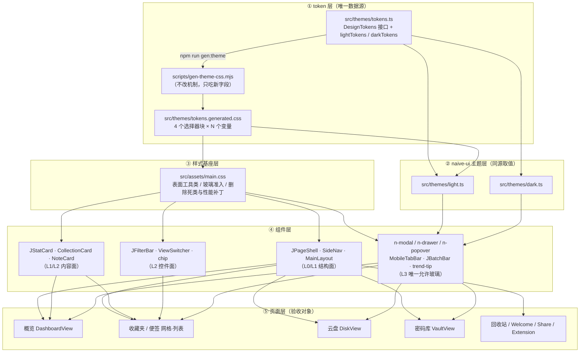
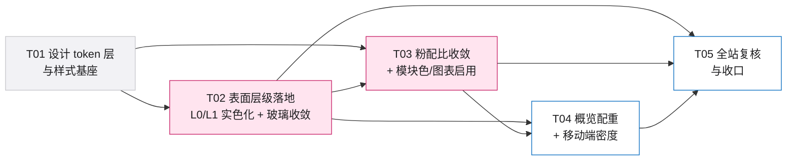

# DESIGN · 2026-10 · JNClub 视觉体系重塑（技术设计与任务分解）

> 类型：**增量技术设计**（只描述本轮变更，不重述项目全貌）
> 上游：`docs/PRD-2026-10-visual-refresh.md`（514 行）
> 下游：`docs/sequence-diagram.mermaid`、`docs/class-diagram.mermaid`
> 作者：架构师 高见远
> 范围：仅 `jnclub-web/`。`music-frontend/`、`src/modules/devtools/` **不在范围**。
> 结论先行：**本轮不新增依赖、不改功能与路由、不改 token 生成机制**。改造只有三件事——① 在 `tokens.ts` 增补 10 个语义 token（表面层 4 + 模块色压深档 4 + 图表序列 2 组共 4，其中 2 组用 var 别名）；② 把「平铺在页面里的玻璃」换成实色 + 中性描边（玻璃规则 47 → 11 条）；③ 把品牌粉从「环境色」收回到「指示器」，把模块色从「定义了没启用」提到「图标 + 图表」唯一载体。

---

## 一、实现方案总览

### 1.1 一句话说清改造路径

> **先在 token 层把「表面」和「颜色角色」变成有名字的语义变量，再按「有内容从其下方经过才允许 blur」这一条判据把 47 条玻璃规则砍到 11 条、把 50 处 `--glass-bg-trans` 换成 `--surface-1` 实色，最后才动粉色配比与图表色——顺序不能反，因为粉色退场需要实色表面接住层级，否则页面会变成一片灰。**

### 1.2 传导关系（token 层 → 组件层 → 页面）



### 1.3 四层落地对照（PRD 3.1 → 本设计的 token 归属）

| 层 | PRD 语义 | 本设计的填充 token | 描边 token | 阴影 | 是否 blur |
| --- | --- | --- | --- | --- | --- |
| **L0 page** | 页面底，不承载内容 | `--bg-page`（**值不改**，Q1/Q6 已定）+ `--surface-glow`（全站唯一一层 ≤6% 光晕） | 无 | 无 | ❌ |
| **L1 surface** | 内容面板，承载信息的最小容器 | **`--surface-1`（新增）** | **`--surface-border`（新增）** | `--shadow-1` | ❌ |
| **L2 raised** | 从 L1 浮起一档：hover / 选中 / 内嵌块 / 图标盒 | 亮：`--surface-1`（同 L1，靠阴影抬升）<br/>暗：`--hover-bg`（`#323238`） | `--surface-border-strong`（新增）/ 选中态 `--brand` | `--shadow-card-hover` | ❌ |
| **L3 overlay** | 浮起于内容之上，有内容从其下方经过 | `--glass-bg-trans`（复用）/ `--panel-bg`（复用） | `--glass-border`（**亮色值改中性**） | `--glass-shadow` / `--panel-shadow` | ✅ |

**命名决策（最小改动 + 语义清晰）**

| 决策 | 理由 |
| --- | --- |
| L0 **复用** `--bg-page`，不新增、不改值 | Q1/Q6 已定不动；改它会连锁 naive `bodyColor`（R2） |
| L1 **新增** `--surface-1`，不复用 `--bg-card` | `--bg-card` 当前有 33 处消费，其中 20+ 在 `modules/devtools`（不在范围、不可改）。若直接把 `--bg-card` 语义改成「L1 结构面」，会与 devtools 的「控件面」语义打架。新增 `--surface-1` 后：**结构面用 `--surface-1`，控件面（chip 底 / 下拉项 / sortable-fallback）继续用 `--bg-card`**，两者当前同值（`#FFF` / `#26262A`），未来可独立演进 |
| L2 **不新增填充 token** | 亮色 L2 = L1 填充 + 阴影（PRD 3.3 明确「亮色靠阴影抬升」）；暗色 L2 = 既有 `--hover-bg`。新增 `--surface-2` 会立刻变成「值与 `--surface-1`/`--hover-bg` 完全重复」的准死 token，违反 PRD 8.1「新增 token 全部有消费」 |
| L3 **复用** `--glass-*` / `--panel-bg` | PRD 3.1 已定；且 `main.css` 已有全站弹层覆盖（`.n-modal` / `.n-drawer` / `.n-popover` / `.n-message`），无需再造一层 |
| 描边 **新增** `--surface-border` / `--surface-border-strong` | 亮色 `--glass-border` 现值 `rgba(255,255,255,.6)` 是白底白描边（隐形，PRD 3.3 的关键修正）。`--border`（`#D1D1D6`）已被 naive 用作 `borderColor`/`dividerColor`（输入框、表格线），语义是「控件边框」而非「结构面边框」，混用会牵动表单观感 |
| 光晕 **新增** `--surface-glow` | 现有 `--glass-glow-top` 是 16% 粉，被 12 处消费（含弹窗内的品牌光晕）。L0 只允许 ≤6% 且全站一处来源，需要一个独立 token，而不是把 `--glass-glow-top` 改成 6%（那会把弹窗光晕也一起打淡） |

---

## 二、表面层级 token 规格表（可直接实现）

### 2.1 新增 / 变更 token 全表

> 全部写入 `src/themes/tokens.ts` 的 `DesignTokens` 接口 + `lightTokens` + `darkTokens` + `tokensToCSSVars()`。
> 生成物 `src/themes/tokens.generated.css` **不手改**，由 `npm run gen:theme` 产出。

| # | TS 字段 | CSS 变量 | 亮色值 | 暗色值 | 语义 | 预期消费处（防死 token） |
| --- | --- | --- | --- | --- | --- | --- |
| 1 | `surface1` | `--surface-1` | `#FFFFFF` | `#26262A` | L1 结构面填充（实色，alpha=1） | `JPageShell .j-page-body`、`SideNav .side-nav`、`Home .folder-column/.collection-column`、`DashboardView .panel/.greet-card/.quick-bar`、`JStatCard`、`JErrorState`、`JEmptyState`、`JSkeletonGrid/List`、`ViewSwitcher`、`VaultView .glass-panel` 消费处、`Welcome/Share/Extension` 卡片 ≈ **20 处** |
| 2 | `surfaceBorder` | `--surface-border` | `#D8D8DE` | `#3F3F46` | L1 1px 中性描边 | 同上 ≈ **20 处** |
| 3 | `surfaceBorderStrong` | `--surface-border-strong` | `#C7C7CC` | `#4A4A52` | L2 / hover / 内嵌块描边 | 卡片 hover、列表行、`JInlineEmpty` 虚线框、图标盒描边 ≈ **8 处** |
| 4 | `surfaceGlow` | `--surface-glow` | `rgba(236, 91, 142, 0.06)` | `rgba(255, 143, 171, 0.06)` | L0 唯一品牌光晕（≤6%） | **1 处**：`MainLayout .app-content` |
| 5 | `moduleBookmarkIcon` | `--module-bookmark-icon` | `#7C5CFF` | `#8F81F8` | 收藏图标描边色 | 图标盒 + 图表 ≈ **2 处** |
| 6 | `moduleNoteIcon` | `--module-note-icon` | `#0A6FC2` | `#5AA9F7` | 便签图标描边色 | 同上 **2 处** |
| 7 | `moduleFileIcon` | `--module-file-icon` | `#0D8261` | `#42BD9A` | 云盘图标描边色 | 同上 **2 处** |
| 8 | `moduleVaultIcon` | `--module-vault-icon` | `#A76611` | `#E09E48` | 密码库图标描边色 | 同上 **2 处** |
| 9 | `chartSeries1` | `--chart-series-1` | `#C9256A` | `#FF8FAB` | 图表首序列（收藏）= 品牌粉**压深档** | `DashboardView TREND_SERIES` **1 处** |
| 10 | `chartSeries2` | `--chart-series-2` | `var(--module-note-icon)` | 同左 | 图表第 2 序列 | 同上 **1 处** |
| 11 | `chartSeries3` | `--chart-series-3` | `var(--module-file-icon)` | 同左 | 图表第 3 序列 | 同上 **1 处** |
| 12 | `chartSeries4` | `--chart-series-4` | `var(--module-vault-icon)` | 同左 | 图表第 4 序列 | 同上 **1 处** |

> 第 10–12 项刻意用 `var()` 别名而非复制 hex：`tokensToCSSVars()` 只做字符串透传，`--chart-series-2: var(--module-note-icon);` 在同一 `:root` 块内可正常解析。好处是「图表色 = 图标色」由**引用关系**保证，不会因为改一个忘了另一个而漂移；未来若真要解耦图表配色，把这 3 行换成 hex 即可，不需要改任何组件。

### 2.2 变更既有 token（2 项，均为值级改动）

| token | 现值（亮） | 新值（亮） | 原因 |
| --- | --- | --- | --- |
| `--glass-border`（`glassBorder`） | `rgba(255, 255, 255, 0.6)` | `rgba(0, 0, 0, 0.08)` | **这是「糊」的直接技术根因**（PRD 11 章实证）。它被 65 处消费：`.logo-bar` 下分隔线、`.nav-editor-bar` 上分隔线、`.tag-bar` 边框、`.quick-bar` 虚线框、`n-dialog__title` 下分隔线、`n-card__header` 等——全部是「白底上的白线」= 隐形。改成中性 8% 黑后，这些分隔线第一次可见。暗色 `rgba(255,255,255,.14)` **不动**（本来就可见） |
| `--glass-border`（暗） | `rgba(255, 255, 255, 0.14)` | 不变 | — |

> ⚠️ 这是本轮**唯一一个「改值就能修掉一大片视觉问题」的点**，优先级高于任何组件级改动。

### 2.3 明确「不改值」的 token（防误伤）

| token | 现值 | 决定 |
| --- | --- | --- |
| `--bg-page` | 亮 `#F5F5F7` / 暗 `#000000` | **不改**（Q1/Q6）。⚠️ 后果见 §12 开放项 O1/O2 |
| `--bg-card` | 亮 `#FFFFFF` / 暗 `#26262A` | **不改**（naive `cardColor` 从这里取，且 devtools 20+ 处在用） |
| `--border` | 亮 `#D1D1D6` / 暗 `#45454A` | **不改**（naive `borderColor`/`dividerColor`，控件边框语义） |
| `--hover-bg` | 亮 `#F2F2F7` / 暗 `#323238` | **不改**（56 处消费；暗色下它就是 L2 填充） |
| `--brand` / `--brand-text` / `--gradient-btn` | 不变 | 用户明确要求不换品牌色 |
| `--module-bookmark` 等 4 个基色 | 亮不变 / 暗改（见 §3.3） | 亮色基色只用于 soft 底推导，不改 |
| `--glass-bg-trans` / `--panel-bg` / `--glass-shadow` | 不变 | L3 合法玻璃继续用 |
| `--radius-*` / `--fs-*` / `--dur-*` / `--ease*` | 不变 | PLAN-2026-19 已收敛，本轮不动 |

### 2.4 明度阶梯实测（含计算依据）

计算式：sRGB → 线性化（`c/255`，`≤0.03928 ? /12.92 : ((c+0.055)/1.055)^2.4`）→ `Y = 0.2126R + 0.7152G + 0.0722B` → `L* = 116·∛Y − 16`（`Y>0.008856`）。

| 组合 | 实测 ΔL\* | PRD 8.1 目标 | 判定 |
| --- | --- | --- | --- |
| 亮 page `#F5F5F7` ↔ surface `#FFFFFF` | **3.41** | ∈ [3.5, 6] | ⚠️ **差 0.09，未达**（见 O1） |
| 亮 page `#F2F2F5` ↔ surface `#FFFFFF`（若 Q1 反悔） | 4.43 | ∈ [3.5, 6] | 达标（备选） |
| 暗 page `#000000` ↔ surface `#26262A` | **15.30** | ≥ 16 | ⚠️ **差 0.70，未达**（PRD 正文写的 16.6 有误，见 O2） |
| 暗 page `#000000` ↔ `#28282C`（备选） | 16.26 | ≥ 16 | 达标（备选） |
| 暗 surface `#26262A` ↔ raised `#323238` | 5.69 | 无硬指标 | ✅ |
| 亮 surface `#FFFFFF` ↔ raised（同色，靠阴影） | 0 | 无硬指标 | ✅ 设计如此 |

### 2.5 描边可见性实测（G6 的硬指标）

| 描边色 | vs 亮 page `#F5F5F7` | vs 亮 surface `#FFF` | vs 亮 `#F2F2F5` | 判定 |
| --- | --- | --- | --- | --- |
| `#E5E5EA` | 1.15 | 1.26 | 1.12 | ❌ 不达标 |
| `#E0E0E5` | 1.21 | 1.32 | 1.18 | ⚠️ 贴线 |
| **`#D8D8DE`（选定 `--surface-border`）** | **1.30** | **1.42** | **1.27** | ✅ 达标且有余量 |
| **`#C7C7CC`（选定 `--surface-border-strong`）** | **1.55** | **1.68** | **1.51** | ✅ |
| `#D1D1D6`（既有 `--border`，不用于结构面） | 1.40 | 1.52 | 1.36 | ✅ 但偏重，且会与控件边框混淆 |

| 暗色描边色 | vs 暗 surface `#26262A` | vs 暗 page `#000` | 判定 |
| --- | --- | --- | --- |
| **`#3F3F46`（选定 `--surface-border`）** | **1.44** | 2.01 | ✅ |
| **`#4A4A52`（选定 `--surface-border-strong`）** | **1.72** | 2.39 | ✅ |

> 结论：亮色下只要把描边从「白 60%」换成 `#D8D8DE`，G6（≥1.2:1）从「0 处达标」变成「全站达标」。**这就是 Q1 选择「不动 `--bg-page`」仍然成立的技术前提。**

### 2.6 「玻璃准入」判据（落成可 grep 的规则）

**语义规则（PRD 3.2）**：玻璃 = 有内容从其下方经过。

**工程判据（可机械执行，四选一必须为真才允许 blur）**：

| 判据 | 可 grep / 可断言的形态 | 例 |
| --- | --- | --- |
| **J1 · 固定定位浮层** | 选择器块内含 `position: fixed` 或 `position: sticky` 且 `bottom:` / `top:` 有值 | `.mobile-tabbar`、`.j-batch-bar` |
| **J2 · 绝对定位浮层** | 选择器块内含 `position: absolute` + `z-index` ≥ 2 | `.trend-tip`、`.outline-float` |
| **J3 · naive 弹层根类** | 选择器以 `.n-modal` / `.n-dialog` / `.n-drawer` / `.n-popover` / `.n-message` / `.n-notification` / `-mask` 开头 | `main.css` §弹层覆盖 |
| **J4 · 视口级顶栏** | 选择器为 `header` 元素或类名含 `header` 且其父级是 layout 容器 | `.glass-header`（AppHeader 的 `<header>`） |

**反判据（命中任一条，必须实色）**：

| 反判据 | 形态 | 当前命中 |
| --- | --- | --- |
| **N1 · 页面壳** | 选择器是 layout/页面容器（`.j-page-body` / `.content-area` / `.side-nav` / `.app-content`） | 4 处 |
| **N2 · 内容在内部滚** | 选择器块内含 `overflow-y: auto` 或 `overflow: hidden` + 子元素列表 | `.collection-column`、`.folder-column`、`.tag-bar` |
| **N3 · 平铺卡片** | 选择器是卡片/面板类（`-card` / `-panel` / `.panel` / 统计卡 / 空态 / 骨架） | ~30 处 |
| **N4 · 内联控件** | 选择器是按钮/切换器/chip（`-btn` / `-switcher` / `-chip`） | `ViewSwitcher`、`.io-export-btn`、`.io-btn` |

**验收脚本（写进 T05）**：

```bash
# ① 全仓玻璃规则计数（含 webkit 双写），目标 ≤30
grep -ro "backdrop-filter: blur" jnclub-web/src | wc -l

# ② 逐条列出仍存在的规则，人工对照 J1–J4
grep -rn "^[^-]*backdrop-filter: blur" jnclub-web/src

# ③ L1 实色断言（浏览器内）
# [...document.querySelectorAll('.j-page-body,.side-nav,.folder-column,.collection-column,.panel,.j-stat-card')]
#   .forEach(el => { const a = getComputedStyle(el).backgroundColor;
#     if (!/^rgb\(/.test(a)) console.error('非实色', el.className, a) })

# ④ 同屏玻璃层数
# [...document.querySelectorAll('*')].filter(el => {
#   const s = getComputedStyle(el);
#   return s.backdropFilter && s.backdropFilter !== 'none'
#     && s.display !== 'none' && el.getBoundingClientRect().width > 0
# }).length
```

---

## 三、模块色与图表色板规格表（含对比度实测）

### 3.1 为什么必须分「基色 / 图标色」两档（R1 处置）

WCAG 2.2 **SC 1.4.11 Non-text Contrast** 要求「理解内容所必需的图形对象」与相邻颜色对比 ≥ **3:1**。图标（20px 描边）、图表数据标记（8px 圆点 / 9px 柱）属此类。实测现状：

| 现有模块色（亮） | L\* | vs `#FFFFFF` | vs `#F5F5F7` | vs `#F2F2F5` | 判定 |
| --- | --- | --- | --- | --- | --- |
| `--module-bookmark` `#7C5CFF` | 50.9 | 4.35 | 3.99 | 3.89 | ✅ |
| `--module-note` `#2F9DF7` | 62.9 | **2.88** | **2.65** | **2.58** | ❌ |
| `--module-file` `#0FBF8C` | 68.9 | **2.37** | **2.18** | **2.12** | ❌ |
| `--module-vault` `#F0A13A` | 72.4 | **2.13** | **1.96** | **1.91** | ❌ |
| `--brand` `#EC5B8E` | 59.2 | 3.25 | **2.99** | 2.91 | ⚠️ 白底刚过、`#F5F5F7` 不达标 |
| `--brand-text` `#C9256A` | 45.3 | 5.31 | 4.87 | 4.75 | ✅ |

**结论：4 个模块色里 3 个不达标，品牌粉本身在页面底上也不达标。P0-3 若直接启用 = 新增无障碍缺口。** 处置：新增 `--module-*-icon` 亮色压深档（L\* 落在 46–51），**原基色保留不动**，只用于推导图标盒的 soft 底色（`color-mix`），因此「模块色相锚点」与「可访问描边色」职责分离。

### 3.2 亮色压深档：取值与实测

| 模块 | 基色（保留，仅用于 soft 底） | **图标色 `--module-*-icon`** | 色相/饱和/明度 | L\* | vs `#FFF` | vs `#F5F5F7` | vs `#F2F2F5` | vs soft 底（12%） | 判定 |
| --- | --- | --- | --- | --- | --- | --- | --- | --- | --- |
| 收藏 | `#7C5CFF` | **`#7C5CFF`**（已达标，沿用） | hsl(252,100,68) | 50.9 | 4.35 | 3.99 | 3.89 | 3.72（`#EFEBFF`） | ✅ |
| 便签 | `#2F9DF7` | **`#0A6FC2`** | hsl(207,90,40) | 46.1 | 5.17 | 4.74 | 4.62 | 4.58（`#E6F3FE`） | ✅ |
| 云盘 | `#0FBF8C` | **`#0D8261`** | hsl(163,82,28) | 48.2 | 4.79 | 4.40 | 4.29 | 4.29（`#E2F7F1`） | ✅ |
| 密码库 | `#F0A13A` | **`#A76611`** | hsl(34,82,36) | 49.2 | 4.61 | 4.24 | 4.13 | 4.23（`#FDF4E7`） | ✅ |

- 四个图标色的 L\* 落在 **46.1–50.9**（视觉重量齐平），最低对比 **4.13:1**，全部 ≥3:1 且有余量。
- 「vs soft 底」一列是**真正生效的对比场景**（图标画在 12% 模块色 soft 盒上），不是画在白纸上——这一项必须一起测，否则会用「图标 vs 白底」的达标掩盖「图标 vs soft 盒」的不达标。
- soft 底不用 token，直接 `color-mix(in srgb, var(--module-note) 12%, var(--surface-1))`（项目已在 `main.css:236`、`JStatCard.vue:82` 使用 `color-mix`，无兼容性新增风险）。

### 3.3 暗色档：降饱和 + 对比度收敛（P2-2）

目标区间 **[4.5, 6.5]**（PRD 8.1：既有辨识度又不刺眼）。

| 模块 | 现值 | L\* | vs `#26262A` | 新值 | hsl | L\* | vs `#26262A` | 判定 |
| --- | --- | --- | --- | --- | --- | --- | --- | --- |
| 收藏 | `#8B7CFF` | 59.1 | 4.61 | **`#8F81F8`** | hsl(247,90,74) | 60.2 | **4.78** | ✅ |
| 便签 | `#5AA9F7` | 67.5 | 6.07 | **`#5AA9F7`**（不动） | hsl(210,91,66) | 67.5 | **6.07** | ✅ |
| 云盘 | `#2FCFA3` | 74.7 | 7.59 | **`#42BD9A`** | hsl(163,48,50) | 69.4 | **6.44** | ✅ |
| 密码库 | `#F0A13A` | 72.4 | 7.03 | **`#E09E48`** | hsl(34,71,58) | 70.0 | **6.57** | ✅（+0.07，可接受；若要严格 ≤6.5 用 `#E59A38` = 6.47） |

- 暗色下 `--module-*-icon` **与** `--module-*` 基色同值（soft 底用 18% 混合，对比 3.72–4.63，均 ≥3:1）。
- 暗色图标在 soft 底（18%）上的实测：收藏 3.72 / 便签 4.40 / 云盘 4.51 / 密码库 4.63 —— 全部 ≥3:1 ✅。

### 3.4 图表色板（Q3 已定：新增 `--chart-series-*`，不污染 `--module-bookmark`）

| 序列 | 语义 | 亮色 | vs `#FFF` | 暗色 | vs `#26262A` | 判定 |
| --- | --- | --- | --- | --- | --- | --- |
| `--chart-series-1` | 收藏（**首序列 = 品牌粉**） | `#C9256A` | **5.31** | `#FF8FAB` | **7.01** | ✅ |
| `--chart-series-2` | 便签 | `var(--module-note-icon)` = `#0A6FC2` | 5.17 | `#5AA9F7` | 6.07 | ✅ |
| `--chart-series-3` | 云盘 | `var(--module-file-icon)` = `#0D8261` | 4.79 | `#42BD9A` | 6.44 | ✅ |
| `--chart-series-4` | 密码库 | `var(--module-vault-icon)` = `#A76611` | 4.61 | `#E09E48` | 6.57 | ✅ |

> **关键取舍：首序列用 `#C9256A`（`--brand-text` 档）而不是 `#EC5B8E`（`--brand`）。**
> 理由：`#EC5B8E` 在 `#FFFFFF` 上 3.25:1（刚过线），在 `#F5F5F7` 上 **2.99:1（不达标）**。图表柱是「理解内容所必需的图形对象」，必须 ≥3:1。`#C9256A` 是既有品牌粉压深档（4.87:1 vs page），色相仍是 335° 的玫红，视觉上依然读作「品牌粉那条最重要的线」，同时满足 G2（饱和粉 ≤2%，压深档更暗、面积感知更小）。

### 3.5 模块色的面积纪律（Q8 已定：允许 5 色相，严守 3%）

| 允许 | 禁止 |
| --- | --- |
| 20px 图标描边（`stroke`/`color`） | 任何 `background` 大面积填充 |
| 8px 数据圆点、9px 数据柱 | 任何 `border-color` |
| 图标盒的 soft 底（≤18% 混合，视为中性面） | 任何文字 `color`（除图表图例的 8px 圆点旁文字保持 `--text-2`） |

---

## 四、玻璃层收敛清单（47 → 11 条）

### 4.1 保留清单（11 条规则，满足 J1–J4 之一）

| # | 文件:行 | 选择器 | 判据 | 层级 | 说明 |
| --- | --- | --- | --- | --- | --- |
| 1 | `main.css:237` | `.glass-header` | J4 | L3 | 顶栏，内容滚动时从其下经过（`AppHeader.vue:241` 消费） |
| 2 | `main.css:261` | `.glass-card--modal` | J3（语义上等同弹层） | L3 | 仅剩 3 个真浮层消费：`NoteEditor .template-menu`、`ReadingModal .reader-settings-panel`、`PasswordEditorModal .pwd-modal`。**`DashboardView .greet-card` 必须移除该类**（R6） |
| 3 | `main.css:334` | `.n-modal-mask, .n-drawer-mask` | J3 | L3 | 弹层遮罩（用 `--overlay-blur` 6px） |
| 4 | `main.css:347` | `.n-modal, .n-dialog, .n-modal .n-card` | J3 | L3 | 弹窗本体 |
| 5 | `main.css:363` | `.n-drawer, .n-drawer-content-wrapper` | J3 | L3 | 抽屉 |
| 6 | `main.css:370` | `.n-popover` | J3 | L3 | 气泡/下拉/`NDropdown` 内部即 NPopover |
| 7 | `main.css:383` | `.n-message, .n-notification` | J3 | L3 | 全站 205 处 `message.*` 调用面（`main.css:376-379` 的历史决策仍然成立） |
| 8 | `MobileTabBar.vue:161` | `.mobile-tabbar` | J1 | L3 | 移动端 TabBar，内容从其下经过（PRD 7.6 明确保留） |
| 9 | `JBatchBar.vue:68` | `.j-batch-bar` | J1 | L3 | 批量操作条（`Home.vue:583`、`DiskView.vue:530` 消费） |
| 10 | `DashboardView.vue:885` | `.trend-tip` | J2 | L3 | 图表悬浮 tooltip（唯一允许模糊的图表元素） |
| 11 | `NoteEditor.vue:1347` | `.outline-float` | J2 | L3 | 笔记大纲浮层，浮于正文之上 |

**计数校验**：11 条规则 × 2（`backdrop-filter` + `-webkit-backdrop-filter`）= **22** 次 grep 命中；`modules/devtools` 有 2 条（`DevtoolsPalette` 命令面板 = J3 合法、`ToolCurl` 遮罩 = J3 合法，**不在改造范围**）→ +4 = **26 ≤ 30** ✅，余量 4。

### 4.2 移除清单（36 条，改为实色）

| 分组 | 文件:行 | 选择器 | 替换为 |
| --- | --- | --- | --- |
| **页面壳（N1）** | `MainLayout.vue:100-103` | `.app-content` | `--bg-page` + **单层** `--surface-glow`（原 2 层 16% 粉 → 1 层 6%） |
| | `JPageShell.vue:63-70` | `.j-page-body` | `--surface-1` + `--surface-border` + `--shadow-1`；**删光晕、删 blur、删 `--glass-shadow`** |
| | `SideNav.vue:211-213` | `.side-nav` | `--surface-1` + 右侧 `1px --surface-border`；删 blur（P1-1） |
| | `Home.vue:656-660` | `.content-area` | **删掉全部光晕**（`background` 整条删除，回到透明继承 L0） |
| **容器（N2）** | `Home.vue:677-686` | `.folder-column` | `--surface-1` + `--surface-border` + `--shadow-1` |
| | `Home.vue:694-703` | `.collection-column` | 同上 |
| | `Home.vue:733-741` | `.tag-bar` | `--hover-bg` + `--surface-border`（内嵌 L2 块） |
| | `Home.vue:847-850` | `.mobile-dir-drawer :deep(.n-drawer-body-content-wrapper)` | 删除（`.n-drawer` 已是玻璃，重复叠加） |
| | `DirectoryDrawer.vue:63` | 同上 | 删除 |
| | `NavEditorDrawer.vue:143` / `CursorSettingsDrawer.vue:213` / `ParticlesSettingsDrawer.vue:102` | 各 drawer body | 删除（理由同上） |
| | `NavEditorDrawer.vue:196` | `.editor-row` | `--hover-bg` + `--surface-border-strong`（行不是浮层） |
| **卡片/面板（N3）** | `DashboardView.vue:653-664` | `.panel` | `--surface-1` + `--surface-border` + `--shadow-1`（**去掉粉边框 `--glass-chip-border` 与 `--glass-shadow`**） |
| | `DashboardView.vue:955-969` | `.greet-card` | `--surface-1` + `--surface-border` + `--shadow-1`；**模板移除 `glass-card--modal` 类**（R6）；高度 ≤76px；左侧 3px `--brand` 竖条 |
| | `DashboardView.vue:769-775` | `.quick-bar` | `--hover-bg` + `1px dashed --surface-border` |
| | `JStatCard.vue:65-70` | `.j-stat-card` | `--surface-1` + `--surface-border` + `--shadow-1` |
| | `JErrorState.vue:25` | `.glass-card` → 消费处 | 删 `glass-card` 类，改 `--surface-1` + `--surface-border`；`main.css .glass-card` 规则随之**整条删除**（唯一消费者） |
| | `JEmptyState.vue:136-141` | `.empty-state-card` | `--surface-1` + `--surface-border`；**删径向粉光**（P2-1） |
| | `JInlineEmpty.vue:71` | 内嵌空态 | `--hover-bg` 底 + `1px dashed --surface-border` |
| | `JSkeletonGrid.vue` / `JSkeletonList.vue` | 骨架容器 | `--surface-1` + `--skeleton-base`，删 blur 与粉光 |
| | `VaultView.vue:429` / `:470` | `.glass-panel`（master-guide / master-lock） | 删 `glass-panel` 类，改 `--surface-1` + `--surface-border` + `--shadow-1` |
| | `RecycleView.vue:329` | `.recycle-config-bar` | `--hover-bg` + `--surface-border` |
| | `RecycleView.vue:435` | `.recycle-item` | `--surface-1` + `--surface-border`（L1 行） |
| | `RecycleView.vue:491` | `.recycle-danger-btn` | 删 blur（按钮，N4） |
| | `DiskView.vue:626` | `.upload-progress-card` | `--surface-1` + `--surface-border` |
| | `DiskView.vue:820` | `.batch-bar` | **整条规则删除**（模板零引用 = 死 CSS；批量条已统一到 `JBatchBar`） |
| | `ModuleToolbar.vue:105` | `.io-export-btn` | 删 blur（按钮，N4） |
| | `NoteEditor.vue:1057` | `.note-editor` | `--surface-1`（编辑器舞台） |
| | `NoteEditor.vue:1153` | `.backlinks-panel` | `--surface-1` + `--surface-border` |
| | `NoteEditor.vue:1286` | `.io-btn` | 删 blur（按钮） |
| | `NoteEditor.vue:1431` | `.outline-float__reopen` | `--surface-1` + `--shadow-2`（重开按钮，改实色给 30 次预算留余量） |
| | `NoteEditor.vue:1585` | `.guide-card` | `--surface-1` + `--surface-border` |
| | `ViewSwitcher.vue:41` | `.view-switcher` | `--hover-bg` + `--surface-border`（内联控件，N4） |
| **边缘页（N3）** | `ExtensionPage.vue:222/242/260` | `.dl-section` / `.feature-card` / `.download-box` | `--surface-1` + `--surface-border` |
| | `Welcome.vue:178/201/251` | `.theme-toggle` / `.welcome-inner` / `.feature-card` | `--surface-1` + `--surface-border`（`.theme-toggle` 用 `--bg-card`） |
| | `ShareView.vue:174` | `.share-card` | `--surface-1` + `--surface-border` |
| **顶栏状态条** | `App.vue:212` | `.offline-banner` | `--glass-bg-solid` 实色 + `1px --surface-border`（状态条，内容不从其下经过；这样能省出 2 次 grep 预算） |

### 4.3 必须同步删除的死代码与补丁

| 位置 | 内容 | 处置 |
| --- | --- | --- |
| `main.css:498-511` | `.side-nav/.folder-column/.collection-column { backdrop-filter: none !important; … background: 双径向 + glass-bg-trans !important }` | **整条删除**，但**保留 3 行注释**记录历史：「2026-10 起这三个容器已改实色，原为规避 Windows 合成器开销而写的『渐变模拟玻璃』补丁随之删除」。<br/>⚠️ **这是最容易踩的坑**：若只删 `backdrop-filter: none` 而留下 `background: … !important`，则 `SideNav.vue` / `Home.vue` 里所有实色改动都会被这条 `!important` 压掉，且不会报错（见 §11 坑 1） |
| `main.css:246-253` | `.glass-card` 整条规则 | 删除（唯一消费者 `JErrorState` 改实色） |
| `main.css:255-265` | `.glass-card--modal` | **保留**（3 个真浮层在用） |
| `main.css:267-275` | `.glass-chip` | 删除（模板零引用，死类） |
| `main.css:314-320` | `.glass-panel` | 保留填充/阴影，**删 blur**（`VaultView` 改实色后仅剩 `main.css` 内部引用） |
| `main.css:147-153` | `.card-top-bar` | **删除**（Q2 已定删顶条；`CollectionCard.vue:115`、`NoteCard.vue:108` 两处模板一并删） |
| `main.css:220-232` | `.sidebar-glow::after` | **删除**（P1-1：侧栏粉色底光） |
| `main.css:155-186` | `.chip` / `.chip-active` | 保留，但 `.chip-active` 的 `border-color: var(--glass-chip-border)` 改 `--brand-text`（粉边框配额让位） |
| `tokens.ts` `gradientTopBar` | `--gradient-top-bar` | 顶条删除后**零消费**。**保留 token 定义**并在 `tokensToCSSVars` 中保留（历史兼容），但需在 T05 复核：若判定「死 token 0」不可违反，则连同 `DesignTokens.gradientTopBar` 字段一起删 |

---

## 五、Naive UI overrides 字段级改动清单

### 5.1 必改（2 项）

| 文件 | 字段 | 现值 | 新值 | 原因 |
| --- | --- | --- | --- | --- |
| `light.ts` / `dark.ts` | `common.cardColor` | `t.bgCard` | `t.surface1` | 语义归位到 L1。值当前相同（`#FFF` / `#26262A`），**零视觉变化**，但保证未来 `--surface-1` 独立演进时 naive 卡片跟随 |
| `light.ts` / `dark.ts` | `Layout.siderColor` | `t.bgCard` | `t.surface1` | 侧栏改 L1 实色（P1-1），naive sider 底色与 `SideNav.vue` 的 `--surface-1` 必须同源 |

### 5.2 建议改（3 项，可放到 T05 收口）

| 文件 | 字段 | 现值 | 建议值 | 说明 |
| --- | --- | --- | --- | --- |
| `light.ts` / `dark.ts` | `Card.color` | 未覆盖（吃 naive 默认，派生自 `cardColor`） | `t.surface1` | 显式化，防 naive 升级漂移 |
| `light.ts` / `dark.ts` | `Card.borderColor` | 未覆盖 | `t.surfaceBorder` | 让裸 `NCard` 也拿到中性描边（弹窗内 `.n-modal .n-card` 被 `main.css` 强制透明，不受影响） |
| `light.ts` / `dark.ts` | `Dialog.color` / `Drawer.color` / `Popover.color` / `Message.color` | 未覆盖（派生自 `modalColor`/`popoverColor`） | **不加** | `main.css:339-387` 已用 `!important` 全局接管弹层背景，再加一层会形成「两处都改才能生效」的隐性耦合。保持现状，在注释里写明「弹层背景由 `main.css` 的 L3 规则接管，此处不覆盖」 |

### 5.3 明确不改（列出以防误伤）

| 字段 | 现值 | 不改的理由 |
| --- | --- | --- |
| `common.bodyColor` | `t.bgPage` | Q1/Q6 不动 page（R2 的连锁风险正来自这里） |
| `common.borderColor` / `dividerColor` | `t.border`（`#D1D1D6`） | 这是**控件边框**语义（输入框、表格线）。结构面描边走新增的 `--surface-border`，两套并行不冲突 |
| `common.hoverColor` | `t.hoverBg` | 暗色下 `#323238` 正是 L2 填充，无需改 |
| `common.boxShadow1/2/3` | `shadow1` / `shadowPopover` / `glassShadow` | 1=卡片、2=气泡、3=模态，与四层体系一一对应，已经正确 |
| `Layout.color` | `t.bgPage` | L0 语义正确 |
| `Layout.headerColor` | `t.bgCard` | `AppHeader` 用 `.glass-header`（`color-mix` 80% + blur）覆盖，naive 值仅作兜底；改它会改变兜底观感，收益为 0 |
| `common.fontSize*` / `cubicBezier*` / `borderRadius*` | 现状 | PLAN-2026-19 已收敛，本轮不动 |

> **联动校验方法（T05 执行）**：改完 `light.ts`/`dark.ts` 后必须逐项走查——① 弹窗内 `n-input` 底色与描边（受 `main.css:393-409` 的 `--n-color` 覆盖）；② `n-base-selection` 下拉（`--n-color` 同上）；③ `n-empty`（吃 `textColor3`）；④ `n-data-table` 表头分隔线（吃 `dividerColor`）。若任一出现「比改造前更糊」，回滚该项而非回滚整批。

---

## 六、token 生成管线兼容性（D）

### 6.1 `scripts/gen-theme-css.mjs` **无需改动**

| 检查点 | 结论 |
| --- | --- |
| 新增字段如何进 CSS | `tokensToCSSVars()` 是 `Record<string,string>` 的显式映射表，**必须手动加 10 行键值对**；生成脚本本身零改动 |
| `var()` 值能否透传 | 能。`rule()` 只做 `key: value;` 字符串拼接，`--chart-series-2: var(--module-note-icon);` 会被原样写入 `:root` / `[data-theme]` 四个块，CSS 变量解析在同块内完成 |
| `--check` 模式 | `npm run gen:theme` 之后生成物与 `tokens.ts` 一致；CI 的 `--check` 不会因为新增字段报错 |
| 4 个选择器块 | `:root` / `@media(prefers-color-scheme:dark) :root:not([data-theme])` / `:root[data-theme='light']` / `:root[data-theme='dark']`。新增 token 会自动进入全部 4 块，**不要手写任何一块** |
| esbuild 加载路径 | `transformSync` 做纯类型擦除，新增字段是纯数据，不影响 |

**唯一纪律**：`src/themes/tokens.generated.css` 是生成物，**禁止手改**。改 `tokens.ts` → 跑 `npm run gen:theme` → 提交两个文件。

### 6.2 `scripts/check-template-root.mjs` 兼容性

判据是「模板根层级有注释 **且** 根元素恰好 1 个」。本轮改动会大量触碰 `<template>`，风险点：

| 风险动作 | 后果 | 规避 |
| --- | --- | --- |
| 删 `<div class="card-top-bar"></div>` 时顺手在旁边加 `<!-- 2026-10 删除顶条 -->` | 若该组件根元素恰好 1 个 → 变 Fragment → `App.vue` 的 `<Transition mode="out-in">` 卡死、整页白屏、**无任何报错** | 注释写进 `<script setup>` 的 JSDoc，或写进根元素**内部** |
| 给 `JPageShell` / `DashboardView` 等单根组件加结构说明注释 | 同上 | 同上 |
| 拆/并元素导致根元素数从 2 变 1 | 原本「刻意多根」的组件变成「单根 + 注释」→ 从 note 升级为 error | 改完必须跑 `npm run check:template-root` |

**验收卡点**：每个阶段的收尾都必须执行
```bash
cd jnclub-web && npm run gen:theme && npm run check:template-root
```
输出 `[check-template-root] 通过` 才允许进入下一阶段。

---

## 七、分阶段实施顺序（E：R4 处置）

> 总原则：**P0-1 必须在 P0-2 之前**（粉色退场需要实色表面接住层级）。在每个阶段内，先概览页落地并截图确认，再铺开。

### 阶段 A · 概览页孤岛（只碰 6 个文件）

| 顺序 | 动作 | 文件 |
| --- | --- | --- |
| A1 | token 层落地 + 重新生成 | `tokens.ts`、`tokens.generated.css`（生成）、`light.ts`、`dark.ts` |
| A2 | 样式基座：`--glass-border` 改值、删 `.glass-card` / `.card-top-bar` / `.sidebar-glow`、删 `main.css:498-511` 性能补丁 | `main.css` |
| A3 | 概览页孤岛实色化 | `JPageShell.vue`、`DashboardView.vue`、`JStatCard.vue`、`JEmptyState.vue`、`JInlineEmpty.vue`、`JSkeletonGrid.vue`、`JErrorState.vue`、`MainLayout.vue` |

**验证卡点 A（不通过不许进 B）**

1. 概览页 1440×900 亮/暗截图各 1 张，与改造前对比存档；
2. `backdrop-filter` 生效元素数 ≤ **3**（预期：AppHeader 1 + trend-tip hover 1）；
3. `.j-page-body` / `.panel` / `.j-stat-card` 的 `background-color` 为 `rgb(...)` 实色（无 `rgba`）；
4. **R4 专项**：滚动 `.j-page-body` 到底部，检查——① 面板圆角处是否露出 1px 白边/缝隙；② 滚动条是否仍贴面板边框内侧；③ `contain: paint`（`.folder-column` 有此声明，概览页无）是否造成裁切；④ 统计卡 6 位数字 `scrollWidth ≤ clientWidth`（降档逻辑不得回归）；
5. 暗色下确认「数字比进度条亮」（P0-4 目标，阶段 A 先记录现状，阶段 D 复核）；
6. `npm run gen:theme && npm run check:template-root` 通过。

**回滚**：本阶段只改 CSS 与 token，`git revert` 涉及的 8 个文件即可；无数据/路由变更。

### 阶段 B · 主壳 + 收藏夹/便签

| 顺序 | 动作 | 文件 |
| --- | --- | --- |
| B1 | 侧栏改 L1 实色、删 `sidebar-glow` 消费 | `SideNav.vue`、`NavItem.vue` |
| B2 | 主壳光晕 2 层 → 1 层 6%、目录栏/内容栏实色 | `MainLayout.vue`、`Home.vue` |
| B3 | 卡片去顶条 / 去粉边 / 图标盒换模块色 / hover 统一 | `CollectionCard.vue`、`NoteCard.vue`、`CollectionRow.vue`、`NoteRow.vue` |
| B4 | chip 语言：透明底 + 粉描边 + 粉字，激活才给 `--brand-soft` | `JFilterBar.vue`、`main.css`（`.chip-active`） |
| B5 | 内联控件与工具条 | `ViewSwitcher.vue`、`ModuleToolbar.vue`、`DirectoryDrawer.vue` |

**验证卡点 B**

1. 收藏夹（网格/列表）× 亮暗 × 1440/390 截图 4 组；
2. 同屏玻璃 ≤ **2**（AppHeader + 批量条）；
3. `grep -c "border[^;]*var(--glass-chip-border)"` 从 34 降到 **≤8**；
4. 单屏粉色承载元素：概览 ≤10 / 收藏夹 ≤12；
5. 四类卡/行 hover 参数逐项一致（阴影 + 位移 + 边框），`translateY` ≤1px；
6. 侧栏与内容区在亮暗两套下靠 1px 描边可分（对比度 ≥1.2:1）。

**回滚**：同上，纯 CSS。

### 阶段 C · 云盘 / 密码库 / 回收站 / 笔记编辑器

| 文件 | 动作 |
| --- | --- |
| `DiskView.vue` | `.upload-progress-card` 实色；**删除死规则 `.batch-bar`**；`.file-item` 内嵌块用 `--hover-bg` + `--surface-border-strong` |
| `VaultView.vue` | `.glass-panel` 消费处改实色；密码揭示气泡**保留 L3 玻璃** |
| `RecycleView.vue` | 3 处实色化 |
| `NoteEditor.vue` | 4 处实色化，`.outline-float` 保留玻璃、`__reopen` 改实色 |
| `JFilterBar.vue` | 移动端 chip 横向滚动单行（Q5 = C）：`flex-wrap: nowrap` + `overflow-x: auto` + `scroll-snap-type: x proximity` + `scrollbar-width: none` |

**验证卡点 C**

1. 云盘/密码库/回收站 × 亮暗 × 1440/390 截图 6 组；
2. 玻璃层数：云盘 ≤2、密码库 ≤2；
3. 390×812：标签筛选区高度 ≤100px、首屏完整卡片 ≥2；
4. 密码揭示气泡仍为玻璃（`backdrop-filter !== 'none'`）；
5. 模块色出现位置仅限图标与图表标记，无背景/边框/文字。

### 阶段 D · 概览配重 + 边缘页 + 全站收口

| 文件 | 动作 |
| --- | --- |
| `DashboardView.vue` | greet-card 移除 `glass-card--modal`、高度 ≤76px、emoji 32→24、左 3px 竖条；`.disk-bar` 渐变 → `--brand` 单色；`TREND_SERIES` 换 `--chart-series-*`；`.trend-grid-line` 改 `1px dashed --surface-border` |
| `JStatCard.vue` | 数字 `font-weight 800→700`；标签 `12→13px` 且 `--glass-text-secondary → --text-2`；图标盒 38→32px；新增 `tone` prop 承载模块色 |
| `Welcome.vue` / `ExtensionPage.vue` / `ShareView.vue` / `NoteEditorPage.vue` | 卡片实色化、去光晕 |
| `App.vue` | `.offline-banner` 改实色 |
| 全站 | 对比度复核、token 覆盖率、字号档位、截图矩阵 24 张 |

**验证卡点 D（= 全量验收）**

1. 概览 1440×900 同屏文本字号档位 ≤ **4**；
2. greet-card `getBoundingClientRect().height` ≤ 76px；
3. 统计卡 `font-weight` = 700、标签 `font-size` ≥ 13px、6 位数字不溢出；
4. 暗色截图：数字为最亮层（不再出现「粉进度条比数字亮」）；
5. `grep -ro "backdrop-filter: blur" src | wc -l` ≤ **30**（预期 26）；
6. 对比度复核：亮色正文 100% ≥4.5:1、非文本图形 100% ≥3:1（**含 4 个 `--module-*-icon` 与 4 个 `--chart-series-*`**）、暗色同两项；
7. token 覆盖率 100%，新增 10 个 token 全部有消费；样式内硬编码 hex 不新增（保持 4 处 vendor 豁免）；硬编码圆角/字号保持 0；
8. 截图矩阵 24 张（PRD 8.3 的 8 行 × 4 态，其中「列表」与「移动端」按表内 — 跳过）全绿。

**回滚**：每阶段独立 commit（A/B/C/D 各 1 个），任一阶段验收失败 → `git revert <该阶段 commit>`，前一阶段成果保留。

---

## 八、精确文件清单（按实现顺序，含改动量）

> 改动量口径：**S** ≤ 10 行 / **M** 11–40 行 / **L** > 40 行。行数指 diff 行数（含删除）。

### 阶段 A

| # | 相对路径（`jnclub-web/` 下） | 改什么 | 量 | 依赖 |
| --- | --- | --- | --- | --- |
| 1 | `src/themes/tokens.ts` | ① `DesignTokens` 接口新增 10 字段（`surface1`/`surfaceBorder`/`surfaceBorderStrong`/`surfaceGlow`/`moduleBookmarkIcon`/`moduleNoteIcon`/`moduleFileIcon`/`moduleVaultIcon`/`chartSeries1..4`，共 13 字段，其中 chart 4 个）；② `lightTokens` 填 10 个新值 + 改 `glassBorder`；③ `darkTokens` 填 10 个新值 + 改 4 个 `module*` 基色；④ `tokensToCSSVars()` 加 10 个键 | **M** | — |
| 2 | `src/themes/tokens.generated.css` | **生成物**，`npm run gen:theme` 产出，不手改 | — | 1 |
| 3 | `src/themes/light.ts` | `common.cardColor` → `t.surface1`；`Layout.siderColor` → `t.surface1`；加 2 行注释说明 L1/L2 语义 | **S** | 1 |
| 4 | `src/themes/dark.ts` | 同 3 | **S** | 1 |
| 5 | `src/assets/main.css` | ① `--glass-border` 用途不变（值在 token 改）；② **删除** `.glass-card`（246-253）、`.card-top-bar`（147-153）、`.sidebar-glow::after`（220-232）、`.glass-chip`（267-275）、`.side-nav/.folder-column/.collection-column` 性能补丁（498-511，留 3 行注释）；③ `.glass-panel` 删 blur 保留填充 | **L** | 1 |
| 6 | `src/shared/layout/MainLayout.vue` | `.app-content` 两层 16% 光晕 → 一层 `--surface-glow` | **S** | 1,5 |
| 7 | `src/shared/layout/JPageShell.vue` | `.j-page-body` 改 `--surface-1` + `--surface-border` + `--shadow-1`，删光晕/blur/`--glass-shadow` | **S** | 1,5 |
| 8 | `src/shared/views/DashboardView.vue` | `.panel`（653-664）、`.greet-card`（955-969，**含模板删 `glass-card--modal`**）、`.quick-bar`（769-775）实色化 | **M** | 1,5 |
| 9 | `src/shared/components/ui/JStatCard.vue` | `.j-stat-card` 实色化 + 中性描边；hover 改 `--surface-border-strong`（不再变粉） | **S** | 1,5 |
| 10 | `src/shared/components/ui/JEmptyState.vue` | 去玻璃、去径向粉光，改 `--surface-1` + `--surface-border` | **M** | 1,5 |
| 11 | `src/shared/components/ui/JInlineEmpty.vue` | 内嵌空态改 `--hover-bg` + 虚线 `--surface-border` | **S** | 1,5 |
| 12 | `src/shared/components/ui/JSkeletonGrid.vue` | 骨架容器去 blur/粉光，底改 `--surface-1` | **S** | 1,5 |
| 13 | `src/shared/components/ui/JSkeletonList.vue` | 同 12 | **S** | 1,5 |
| 14 | `src/shared/components/ui/JErrorState.vue` | 模板删 `glass-card` 类，改 `--surface-1` + `--surface-border` | **S** | 1,5 |

### 阶段 B

| # | 相对路径 | 改什么 | 量 | 依赖 |
| --- | --- | --- | --- | --- |
| 15 | `src/shared/layout/SideNav.vue` | `.side-nav` 改 `--surface-1` + 右 `1px --surface-border`，删 blur；`.logo-bar` / `.nav-editor-bar` 分隔线用 `--surface-border` | **M** | 5,7 |
| 16 | `src/shared/layout/NavItem.vue` | 激活项保留 `--gradient-nav-active` + `--brand-text`；非激活项 hover 用 `--hover-bg`（去粉） | **S** | 15 |
| 17 | `src/modules/bookmark/views/Home.vue` | `.content-area` 删光晕；`.folder-column`/`.collection-column` 实色 + 中性描边；`.tag-bar` 改 `--hover-bg` + `--surface-border`；`.mobile-dir-drawer` 删 blur | **L** | 5,7 |
| 18 | `src/modules/bookmark/components/CollectionCard.vue` | 删 `<div class="card-top-bar">`（115）+ 删 `.card-top-bar` 相关样式；`.favicon-box` 换模块色 soft/icon；hover 去粉边、`translateY(-2px)→(-1px)`；`.card-tag` 改透明底 + 粉描边 + 粉字；`.card-link` 色降级到 `--text-3` | **L** | 1,17 |
| 19 | `src/modules/bookmark/components/NoteCard.vue` | 同 18（模板 108 行顶条、`.icon-box`、hover） | **L** | 1,17 |
| 20 | `src/modules/bookmark/components/CollectionRow.vue` | hover 语言统一到 L2（中性边 + `--shadow-card-hover` + `translateY(-1px)`） | **M** | 17 |
| 21 | `src/modules/bookmark/components/NoteRow.vue` | 同 20 | **M** | 17 |
| 22 | `src/shared/components/ui/JFilterBar.vue` | `.j-filter-chip` 改透明底 + `1px --glass-chip-border` + `--glass-chip-text`；激活态才给 `--brand-soft` 底 + `--brand-text` 字 + 600；`.j-filter-count` 去粉底 | **M** | 5 |
| 23 | `src/shared/components/ViewSwitcher.vue` | 去 blur，改 `--hover-bg` + `--surface-border` | **S** | 5 |
| 24 | `src/modules/bookmark/components/ModuleToolbar.vue` | `.io-export-btn` 删 blur | **S** | 5 |
| 25 | `src/modules/bookmark/components/DirectoryDrawer.vue` | 删 drawer body 的 blur 与 `--glass-bg-trans` 底 | **S** | 5 |

### 阶段 C

| # | 相对路径 | 改什么 | 量 | 依赖 |
| --- | --- | --- | --- | --- |
| 26 | `src/modules/bookmark/components/DiskView.vue` | `.upload-progress-card` 实色；**删死规则 `.batch-bar`**；`.file-item` 内嵌 L2；删 `.batch-bar` 相关注释残留 | **M** | 5,17 |
| 27 | `src/modules/bookmark/components/VaultView.vue` | 2 处 `.glass-panel` 消费改实色；密码揭示气泡保留玻璃 | **M** | 5,17 |
| 28 | `src/modules/bookmark/views/RecycleView.vue` | 3 处实色化 | **M** | 5,17 |
| 29 | `src/modules/bookmark/components/NoteEditor.vue` | 4 处实色化；`.outline-float` 保留玻璃、`__reopen` 改实色 | **M** | 5,17 |
| 30 | `src/shared/layout/NavEditorDrawer.vue` | 删 drawer body blur；`.editor-row` 改 `--hover-bg` + `--surface-border-strong` | **M** | 5 |
| 31 | `src/shared/layout/CursorSettingsDrawer.vue` | 删 drawer body blur | **S** | 5 |
| 32 | `src/shared/layout/ParticlesSettingsDrawer.vue` | 删 drawer body blur | **S** | 5 |

### 阶段 D

| # | 相对路径 | 改什么 | 量 | 依赖 |
| --- | --- | --- | --- | --- |
| 33 | `src/shared/views/DashboardView.vue` | greet-card 高度/emoji/竖条；`.disk-bar` 单色；`TREND_SERIES` 换 `--chart-series-*`；`.trend-grid-line` 改中性虚线；`.trend-switch` / `.layout-item` / `.density-option` 去粉底 | **L** | 8,18,19 |
| 34 | `src/shared/components/ui/JStatCard.vue` | 数字 700 / 标签 13px+`--text-2` / 图标盒 32px / 新增 `tone` prop（`'bookmark'\|'note'\|'file'\|'vault'\|'neutral'`） | **M** | 9 |
| 35 | `src/shared/views/Welcome.vue` | 3 处实色化 + 去光晕 | **M** | 5 |
| 36 | `src/shared/views/ExtensionPage.vue` | 3 处实色化 + 去光晕 | **M** | 5 |
| 37 | `src/shared/views/ShareView.vue` | 1 处实色化 + 去光晕 | **S** | 5 |
| 38 | `src/modules/bookmark/views/NoteEditorPage.vue` | 去光晕 | **S** | 5 |
| 39 | `src/App.vue` | `.offline-banner` 改 `--glass-bg-solid` + `--surface-border` | **S** | 5 |

**合计 39 个文件（含 1 个生成物），净改动预估 ~620 行 diff（删除 ~340 / 新增 ~280）。**

---

## 九、任务列表（有序、带依赖）

> 硬约束：**5 个任务**、每任务 ≥3 文件、T01 必须是基础设施、依赖链尽量扁平（T02/T03 只依赖 T01，避免长链）。

### T01 · 设计 token 层与样式基座（项目基础设施）

- **优先级**：P0
- **涉及文件**：`src/themes/tokens.ts`、`src/themes/tokens.generated.css`（生成）、`src/themes/light.ts`、`src/themes/dark.ts`、`src/assets/main.css`
- **具体改什么**：
  1. `tokens.ts` 按 §2.1 表格新增 10 个 token 字段（亮/暗双值），`lightTokens.glassBorder` 改 `rgba(0,0,0,0.08)`，`darkTokens` 的 4 个 `module*` 基色按 §3.3 更新；
  2. `tokensToCSSVars()` 补 10 个键（顺序放在 `--glass-*` 之后，便于 diff 阅读）；
  3. `npm run gen:theme` 重新生成（**禁止手改生成物**）；
  4. `light.ts` / `dark.ts`：`common.cardColor`、`Layout.siderColor` 改 `t.surface1`（§5.1）；
  5. `main.css`：删除 4 条死规则（`.glass-card`、`.card-top-bar`、`.sidebar-glow::after`、`.glass-chip`）+ 删除 `498-511` 性能补丁（留 3 行历史注释）+ `.glass-panel` 删 blur。
- **验收方式**：① `npm run gen:theme` 输出「亮/暗各 156 个变量」（146+10）；② `npm run check:template-root` 通过；③ `git diff src/themes/tokens.generated.css` 中新增 10 个变量 × 4 个块 = 40 行；④ `grep -ro "backdrop-filter: blur" src | wc -l` 从 95 降到 **89**（删 3 条规则 ×2）；⑤ `npx vue-tsc --noEmit` 无新增错误。
- **依赖**：无
- **预估改动量**：~120 行

### T02 · 表面层级落地：L0/L1 实色化与玻璃收敛

- **优先级**：P0（对应 PRD P0-1）
- **涉及文件**：`MainLayout.vue`、`JPageShell.vue`、`SideNav.vue`、`Home.vue`、`DashboardView.vue`、`JStatCard.vue`、`JEmptyState.vue`、`JInlineEmpty.vue`、`JSkeletonGrid.vue`、`JSkeletonList.vue`、`JErrorState.vue`、`ViewSwitcher.vue`、`VaultView.vue`、`DiskView.vue`、`RecycleView.vue`、`ModuleToolbar.vue`、`NoteEditor.vue`、`DirectoryDrawer.vue`、`NavEditorDrawer.vue`、`CursorSettingsDrawer.vue`、`ParticlesSettingsDrawer.vue`、`Welcome.vue`、`ExtensionPage.vue`、`ShareView.vue`、`NoteEditorPage.vue`、`App.vue`（共 26 个）
- **具体改什么**：按 §4.2 移除清单逐条把 blur 与 `--glass-bg-trans` 换成 `--surface-1` + `--surface-border` + `--shadow-1`；按 §4.1 保留清单确保 11 条玻璃规则一条不少。**严格按阶段 A → B → C → D 的顺序推进**，每阶段截图卡点通过后再进下一阶段（§7）。
- **验收方式**：① 玻璃 grep 计数 ≤30（预期 26）；② 概览页同屏玻璃 ≤3、收藏夹 ≤2、云盘 ≤2、密码库 ≤2；③ 全部 L1 选择器 `backgroundColor` 为 `rgb(...)`；④ 亮色描边对比度 ≥1.2:1（`#D8D8DE` vs `#F5F5F7` = 1.30）；⑤ 暗色 surface 计算值 = `rgb(38,38,42)`（不再是叠出来的 `#1B1B1E`）；⑥ R4 专项走查（1px 缝隙 / 滚动裁切 / `contain: paint`）无破版。
- **依赖**：T01
- **预估改动量**：~280 行

### T03 · 品牌粉配比收敛 + 模块色/图表启用 + hover 语言统一

- **优先级**：P0（对应 PRD P0-2 + P0-3 + P1-1 + P1-2）
- **涉及文件**：`main.css`（`.chip-active`）、`Home.vue`（`.tag-chip`）、`JFilterBar.vue`、`CollectionCard.vue`、`NoteCard.vue`、`CollectionRow.vue`、`NoteRow.vue`、`NavItem.vue`、`SideNav.vue`、`DashboardView.vue`（`TREND_SERIES` + `.trend-switch`/`.layout-item`/`.density-option`）、`JStatCard.vue`（`tone` prop）（共 11 个）
- **具体改什么**：
  1. **粉边框 34 → ≤8**：只有「弹层内输入框 focus」「激活/选中态」保留 `--glass-chip-border`，其余改 `--surface-border`；
  2. **卡片顶条归零**：删模板 2 处 + `main.css` 规则（T01 已删规则，本任务删模板）；
  3. **图标盒**：`background: color-mix(in srgb, var(--module-*) 12%, var(--surface-1))` + `color: var(--module-*-icon)`，删除 `--pink-cherry` 与 `--glow-icon` 用法；
  4. **chip 语言**：透明底 + `1px --glass-chip-border` + `--glass-chip-text`，仅激活态给 `--brand-soft`；
  5. **hover 统一到 L2**：四类卡/行逐项同参数（`--surface-border-strong` + `--shadow-card-hover` + `translateY(-1px)`），粉色只在 `.is-selected`；
  6. **`TREND_SERIES` 换 `--chart-series-1..4`**（**不要**改成 `--module-*`，那是 R5 的坑）。
- **验收方式**：① `grep -c "border[^;]*var(--glass-chip-border)"` ≤8；② `grep -c "card-top-bar"` = 0；③ `grep -c "var(--gradient-top-bar)"` 的模板消费 = 0；④ 单屏粉色承载元素 概览 ≤10 / 收藏夹 ≤12 / 云盘 ≤8 / 密码库 ≤8；⑤ 模块色图标对 soft 底对比度 ≥3:1（4 个值见 §3.2）；⑥ 趋势图 4 序列色值全部来自 `--chart-series-*`；⑦ 四类卡/行 hover 三项参数逐项相同。
- **依赖**：T01、T02
- **预估改动量**：~160 行

### T04 · 概览页视觉配重与移动端密度回正

- **优先级**：P0（P0-4）+ P1（P1-3）
- **涉及文件**：`DashboardView.vue`、`JStatCard.vue`、`JFilterBar.vue`、`Home.vue`（`.chip-bar` 补 `scroll-snap`）、`MobileTabBar.vue`（仅确认不回归）
- **具体改什么**：
  1. greet-card：高度 ≤76px、emoji 32→24px、左 3px `--brand` 竖条、去 `glass-card--modal`（T02 已删类，本任务补 scoped 的 `border`/`box-shadow` 接住，R6）；
  2. JStatCard：`font-weight 800→700`、标签 `12→13px` 且 `--text-2`、图标盒 38→32px、内距收紧（缓解 6 位数字溢出）；**24px 数字档位不动**（decisions-ia.md 决策 6）；
  3. `.disk-bar`：`linear-gradient(90deg, var(--brand), …)` → `var(--brand)` 单色（暗色下让数字成为最亮层）；
  4. 移动端 chip：`JFilterBar` + `Home .chip-bar` 统一 `flex-wrap: nowrap` + `overflow-x: auto` + `scroll-snap-type: x proximity` + `scrollbar-width: none`（Q5 = C，**零新增状态**）。
- **验收方式**：① 概览 1440×900 同屏字号档位 ≤4；② greet-card 渲染高度 ≤76px；③ `font-weight` = 700、标签 ≥13px、6 位数字 `scrollWidth ≤ clientWidth`；④ 暗色截图数字为最亮层；⑤ 390×812 标签区 ≤100px、首屏完整卡片 ≥2；⑥ TabBar 仍为玻璃。
- **依赖**：T02、T03
- **预估改动量**：~80 行

### T05 · 全站复核、死代码清理与收口

- **优先级**：P0（决定本轮是否「达标」而非「看起来更好」）
- **涉及文件**：`scripts/`（新增一次性复核脚本，可选）、`src/themes/tokens.ts`（若需删 `gradientTopBar`）、`src/assets/main.css`（残留清理）、`docs/`（验收报告）
- **具体改什么**：
  1. 跑对比度复核脚本（§3 全部数值 + 正文 4.5:1 + 非文本 3:1，亮暗各一遍）；
  2. 跑 token 覆盖率：定义集 × 使用集求差，**新增 10 个 token 必须全部有消费**；
  3. 检查硬编码 hex / 圆角 / 字号：不新增（保持 4 处 vendor 豁免）、保持 0；
  4. 清理：`--gradient-top-bar` 若零消费则连字段删除；`.glass-chip` / `.card-top-bar` / `.sidebar-glow` 确认无残留引用；
  5. 出 24 张截图矩阵（PRD 8.3）；
  6. 记录 §12 开放项的实测结论。
- **验收方式**：PRD 8.1 主表逐行打勾；截图矩阵全绿；`npm run build`（含 `vue-tsc`）通过。
- **依赖**：T02、T03、T04
- **预估改动量**：~60 行 + 文档

### 依赖图



---

## 十、跨文件共享约定

### 10.1 命名规范

| 类别 | 规则 | 例 |
| --- | --- | --- |
| 表面层填充 | `--surface-1`（L1 结构面）。**不要**用 `--bg-card` 表达结构面 | `.j-page-body { background: var(--surface-1) }` |
| 控件面填充 | 继续用 `--bg-card`（chip 底、下拉项、`sortable-fallback`） | `.chip { background: var(--bg-card) }` |
| 表面描边 | `--surface-border`（L1 常态）/ `--surface-border-strong`（L2、hover、内嵌块） | `border: 1px solid var(--surface-border)` |
| 控件描边 | 继续用 `--border`（输入框、表格线、`n-*` 组件） | `border: 1px solid var(--border)` |
| 模块色 | 图标描边只用 `--module-*-icon`；soft 底必须用 `color-mix(in srgb, var(--module-*) 12%, var(--surface-1))`（暗色 18%） | 见 §3.2 |
| 图表色 | 只用 `--chart-series-1..4`。**禁止**直接写 `--module-*` 或 `--brand` | `TREND_SERIES` |
| 品牌粉 | 只用 `--brand`（填充/渐变）、`--brand-text`（文字/描边）、`--brand-soft`（淡底）、`--glass-chip-border`（1px 淡描边）、`--focus-ring` | 见 PRD 4.1 |
| 玻璃 | 只有 §4.1 的 11 条规则允许 `backdrop-filter`。新代码要加玻璃必须能指出它满足 J1–J4 中哪一条 | — |

### 10.2 禁止事项（违反即视为不达标）

| # | 禁止 | 后果 |
| --- | --- | --- |
| 1 | **禁止在 SFC `<template>` 根层级写 HTML 注释** | 单根变 Fragment → `App.vue` 的 `<Transition mode="out-in">` 卡死 → 整页白屏且**无任何报错**（`decisions-ia.md` 已记录该回归，`check-template-root.mjs` 会拦） |
| 2 | **禁止手改 `src/themes/tokens.generated.css`** | 下次 `predev`/`prebuild` 会被覆盖，改动静默丢失 |
| 3 | **禁止在 `main.css` 里用 `background: … !important` 给 `.side-nav` / `.folder-column` / `.collection-column` 写兜底** | 会压掉组件 scoped 里的实色改动，且不报错（§11 坑 1） |
| 4 | **禁止给 L1/L2 加 `backdrop-filter`** | 直接违反 G3/G5 |
| 5 | **禁止用 `--brand`（`#EC5B8E`）做图标/图表标记色** | 在 `#F5F5F7` 上仅 2.99:1，新增无障碍缺口 |
| 6 | **禁止把模块色用于 `background` / `border-color` / `color`（文字）** | 违反 §3.5 面积纪律，单屏模块色会超 3% |
| 7 | **禁止改 `--bg-page` / `--bg-card` / `--border` / `--hover-bg` 的值** | 会连锁 naive 的 `bodyColor`/`cardColor`/`borderColor`（R2），本轮已决定不动 |
| 8 | **禁止硬编码 hex / 圆角 / 字号** | `PLAN-2026-19` 已归零，回退即验收失败 |
| 9 | **禁止改 `--fs-*` 阶梯与统计数字 24px 档位** | `decisions-ia.md` 决策 6 已闭环，本轮只改字重/标签/内距 |
| 10 | **禁止改 `music-frontend/` 与 `src/modules/devtools/`** | 不在本轮范围 |
| 11 | **禁止在 `--chart-series-*` 之外新建图表色 token** | 会导致「图表是第二套色系」复发 |
| 12 | **禁止给 `--module-*` 基色改名或删除** | 它现在承担「soft 底推导锚点」，删了就成死 token 反面的「断引用」 |

### 10.3 token 引用规则

1. **改样式前先确认消费链**：`tokens.ts` → `npm run gen:theme` → `tokens.generated.css`（4 个选择器块）→ `main.css` / 组件 scoped。
2. **新增 token 必须有消费**：`tokensToCSSVars()` 加键 → 同一次提交里至少一处 `var(--新token)` 消费，否则 CI 的覆盖率检查会挂。
3. **跨层不跨界**：组件层（`shared/components`、`modules/*/components`）只能引用 token 与 `main.css` 的**语义工具类**；不要在组件里重新定义表面材质。
4. **`color-mix` 是唯一允许的「运行时派生色」手段**（项目已在用），不要引入 `@property` / `oklch()` 等新特性。
5. **scoped 优先级**：`main.css` 先于组件 scoped 加载，同 specificity 时 scoped 胜出。因此 `main.css` 里的全局兜底**不要加 `!important`**，否则组件改不动。

---

## 十一、风险与回滚（R1–R6 处置决定 + 新增风险）

### 11.1 PRD 六项风险的处置决定

| # | PRD 风险 | 本设计的决定 | 落地位置 |
| --- | --- | --- | --- |
| **R1** | 模块色作图标色新增无障碍缺口（最高优先） | **采纳 PRD 建议并量化**：新增 `--module-*-icon` 亮色压深档，L\* 落在 46.1–50.9，实测最低 4.13:1（vs soft 底）全部 ≥3:1；暗色降饱和到 [4.78, 6.57] 区间。**验收必须同时测「图标 vs 白底」与「图标 vs soft 盒」两个场景** | §3.2 / §3.3 |
| **R2** | 改 `--bg-page` 的连锁影响 | **Q1 已定不动 page**。因此 R2 风险**归零**，代价是亮色 ΔL\* 只有 3.41（见 O1）。用 `--surface-border`（1.30:1）承接层级职责 | §2.4 / §2.5 |
| **R3** | 删「渐变模拟玻璃」补丁后出现「页面底透出来」 | **决定：整条规则删除，保留 3 行历史注释**。实色比半透明更安全（不存在透出），风险在「`!important` 残留压掉新样式」而非「透出」——已列入 §10.2 禁止事项 3 | §4.3 |
| **R4** | 14 层 blur 移除暴露既有 bug | **决定：分 4 阶段落地，概览页孤岛先行**。阶段 A 的卡点 4 专门检查「1px 缝隙 / 滚动容器裁切 / `contain: paint` 边界」三项 | §7 阶段 A |
| **R5** | `--module-bookmark` 改色是全局语义变更 | **采纳 PRD 建议 B**：不改 `--module-bookmark`，新增 `--chart-series-1..4`；`--chart-series-1` 直接指向品牌粉压深档 `#C9256A`（不是 `#EC5B8E`，理由见 §3.4）。`--module-bookmark` 基色继续承担 soft 底推导锚点，不会变死 token | §2.1 / §3.4 |
| **R6** | `greet-card` 移除 `glass-card--modal` 后样式没接住 | **决定：删类 + 补全 scoped**。该类提供 `background`/`backdrop-filter`/`border`/`box-shadow` 四件事，`DashboardView.vue` 的 scoped `.greet-card` 已覆盖前三项、**没覆盖 `backdrop-filter`**（所以 blur 现在真的在生效）。删类时必须在 scoped 里显式补 `border: 1px solid var(--surface-border)` 与 `box-shadow: var(--shadow-1)`，并确认 `backdrop-filter` 不再继承 | §4.2 / T04 |

### 11.2 新增风险（本设计识别）

| # | 风险 | 概率 | 影响 | 缓解 |
| --- | --- | --- | --- | --- |
| **N1** | `main.css:498-511` 的 `background: … !important` 未彻底删除，导致 `SideNav`/`Home` 的实色改动全部失效且不报错 | **高** | 阶段 B 全部白做，且现象是「改了没反应」而非报错，极易误判为「样式没生效」而反复试错 | T01 验收明确要求 `grep -n "side-nav" src/assets/main.css` 只剩注释、无规则体；阶段 B 卡点 1 的截图必须能看出侧栏变白 |
| **N2** | 亮色 ΔL\*(page↔surface) = 3.41 < PRD 8.1 的 [3.5, 6] | 确定 | 验收表这一行必然标红 | 见 O1：建议把判据改为 `≥3.2` 并附加「描边 ≥1.2:1 必达」 |
| **N3** | 暗色 ΔL\*(`#000`↔`#26262A`) = 15.30 < PRD 的 16（PRD 正文 16.6 计算有误） | 确定 | 同上 | 见 O2：判据改 `≥15` 或暗色 L1 提 `#28282C` |
| **N4** | `--chart-series-2..4` 用 `var()` 别名，若未来有人只改 `--module-*-icon` 会连带改变图表配色 | 中 | 语义耦合 | 已在 §2.1 注明「未来要解耦就把这 3 行换成 hex」，并在 `tokens.ts` 加注释 |
| **N5** | 图标盒从「粉底」改「模块色 soft 底」后，`NoteCard` 与 `CollectionCard` 在同一网格里出现 2 种色相，可能被误判为「不一致」 | 中 | 走查争议 | 这是 P0-3 的**目标**（模块身份），走查时以「图标色 = 图表色 = 模块身份」为准绳；若用户不接受，退回 Q8 的 B 方案（只启用 2 个模块色） |
| **N6** | `JStatCard` 新增 `tone` prop 后，6 张卡里「标签」「回收站」没有对应模块色 | 中 | 2 张卡图标色无处取 | 定义 `tone: 'neutral'` → `--text-3` 描边 + `--hover-bg` 底；「回收站」warn 态继续用 `--danger` / `--danger-soft`（既有语义色，不属品牌粉） |
| **N7** | 移动端 chip 横滑后，「更多」入口可发现性下降（Q5 的已知代价） | 中 | 用户可能找不到标签 | 右侧加 12px 渐隐遮罩（`mask-image`，与 `CollectionCard .card-tags` 同一手法），作为「还有内容」的信号；若用户反馈仍差，退回 Q5 的 B 方案 |

### 11.3 回滚方式

| 粒度 | 操作 | 影响面 |
| --- | --- | --- |
| **单阶段回滚** | 阶段 A/B/C/D 各自独立 commit，`git revert <commit>` | 只回退该阶段 |
| **单文件回滚** | `git checkout HEAD~1 -- <file>` | 最小 |
| **单 token 回滚** | 改回 `tokens.ts` 一个值 + `npm run gen:theme` | 全站立即恢复该 token 原值，**无需改任何组件**（这是 token 化的最大收益） |
| **全局回滚** | `git revert` 全部 5 个 commit + `npm run gen:theme` | 回到改造前 |

**无数据/路由/接口变更，因此不存在「回滚需要迁移数据」的情况**——这是本轮「纯视觉」定位的直接红利。

---

## 十二、开放项（需用户拍板，附我的建议）

| # | 问题 | 事实 | 我的建议 | 若不采纳的备选 |
| --- | --- | --- | --- | --- |
| **O1** | 亮色 page↔surface 的 ΔL\* 判据 | Q1 决定不动 `--bg-page`（`#F5F5F7`），实测 ΔL\* = **3.41**，低于 PRD 8.1 的 `[3.5, 6]`（差 0.09）。该区间原本是按「压深到 `#F2F2F5`」（4.43）写的 | **把判据改为 `ΔL* ≥ 3.2`，并追加硬条件「page↔surface 描边对比度 ≥ 1.2:1 必达」（实测 `#D8D8DE` vs `#F5F5F7` = 1.30 ✅）**。理由：层级辨识的载荷已经从「明度差」转移到「描边 + 阴影」，ΔL\* 3.41 在实色化之后肉眼可辨 | 若坚持 [3.5, 6]：只能把 `--bg-page` 压到 `#F2F2F5`，即推翻 Q1，需重跑 R2 的 naive 连锁走查（`bodyColor` / `n-base-selection` / `n-empty`） |
| **O2** | 暗色 page↔surface 的 ΔL\* 判据 | Q6 决定保持纯黑，实测 `#000` ↔ `#26262A` = **15.30**，低于 PRD 的 `≥16`。**PRD 正文「已达 16.6」的计算有误**（按 CIE L\* 标准式复算为 15.30） | **把判据改为 `≥ 15`**（实测 15.30 已过）。理由同 O1：改 `--bg-card` 会连锁 naive `cardColor`（devtools 20+ 处消费），收益不抵风险 | 若坚持 ≥16：把暗色 `--bg-card` 提到 `#28282C`（16.26）——但这会同时改变所有卡片、`n-card`、devtools 面板的底色，属 R2 类连锁，**不建议** |
| **O3** | `--gradient-top-bar` 是否连字段一起删 | Q2 决定删顶条，删完后 `--gradient-top-bar` 零消费 = 死 token，与「死 token 0」冲突 | **连 `DesignTokens.gradientTopBar` 字段一起删**（T05 执行）。理由：留着是死 token，删了更干净；它只被 `main.css:151` 一处引用 | 若想保留「有顶条」的结构记忆作为未来选项：保留字段但接受「1 个死 token」的验收豁免，需在验收表注明 |
| **O4** | `--module-bookmark` 亮色 `#7C5CFF`（紫）与品牌粉并置是否突兀 | 该色作为图标色在 soft 盒上 3.72:1 达标；但「紫 + 玫红 + 蓝 + 绿 + 橙」5 色相同屏是 Q8 的 A 方案，视觉走查才能定 | **先按 A 方案实施**（Q8 已定），在阶段 D 截图走查时专门看一眼概览页 6 张统计卡的色相分布；若判为「花」，再退回 B 方案（只留收藏=粉，其余中性灰） | 退回 Q8 的 B 方案：`--module-note/file/vault-icon` 全部指向 `--text-3`，仅保留 soft 底差异 |
| **O5** | 移动端 chip 横滑的可发现性 | Q5 已定 C 方案（横向滚动单行）。`Home.vue` 的 `.chip-bar` **已经是** nowrap + `overflow-x: auto`（`Home.vue:875-880`），只需给 `JFilterBar` 补齐同一套写法 + `scroll-snap` + 右缘渐隐 | **按 C 实施**，并补右缘 12px 渐隐遮罩（与 `CollectionCard .card-tags` 同一手法）作为可发现性补偿 | 若用户反馈仍找不到标签：退回 Q5 的 B 方案（仅视觉收紧，chip 区仍占 4 行），或改 A 方案（折叠 2 行 + 更多，但引入新状态） |

---

## 附录 A · 关键数值速查（供 T05 复核脚本直接用）

```
# 亮色
--surface-1              #FFFFFF
--surface-border         #D8D8DE    vs #F5F5F7 = 1.30:1  vs #FFFFFF = 1.42:1
--surface-border-strong  #C7C7CC    vs #F5F5F7 = 1.55:1  vs #FFFFFF = 1.68:1
--surface-glow           rgba(236, 91, 142, 0.06)
--module-bookmark-icon   #7C5CFF    4.35 / 3.99 / 3.89    soft#EFEBFF = 3.72
--module-note-icon       #0A6FC2    5.17 / 4.74 / 4.62    soft#E6F3FE = 4.58
--module-file-icon       #0D8261    4.79 / 4.40 / 4.29    soft#E2F7F1 = 4.29
--module-vault-icon      #A76611    4.61 / 4.24 / 4.13    soft#FDF4E7 = 4.23
--chart-series-1         #C9256A    vs #FFFFFF = 5.31:1
--chart-series-2..4      var(--module-note-icon / -file-icon / -vault-icon)
--glass-border           rgba(0, 0, 0, 0.08)   ← 值变更

# 暗色
--surface-1              #26262A
--surface-border         #3F3F46    vs #26262A = 1.44:1
--surface-border-strong  #4A4A52    vs #26262A = 1.72:1
--surface-glow           rgba(255, 143, 171, 0.06)
--module-bookmark        #8F81F8    vs #26262A = 4.78    soft18%#383550 = 3.72
--module-note            #5AA9F7    vs #26262A = 6.07    soft18%#2F3E4F = 4.40
--module-file            #42BD9A    vs #26262A = 6.44    soft18%#284440 = 4.51
--module-vault           #E09E48    vs #26262A = 6.57    soft18%#4A3C2D = 4.63
--module-*-icon          同基色
--chart-series-1         #FF8FAB    vs #26262A = 7.01
--glass-border           rgba(255, 255, 255, 0.14)   ← 不变

# 明度阶梯
亮 ΔL*(#F5F5F7 → #FFFFFF)      = 3.41
暗 ΔL*(#000000 → #26262A)      = 15.30
暗 ΔL*(#26262A → #323238)      = 5.69

# 计数目标
backdrop-filter: blur       95 → 26  (≤30)
玻璃规则（非 webkit）        47 → 11
var(--glass-bg-trans)       50 → ~6
var(--glass-chip-border) 边框 34 → ≤8
card-top-bar 消费            2 → 0
```
